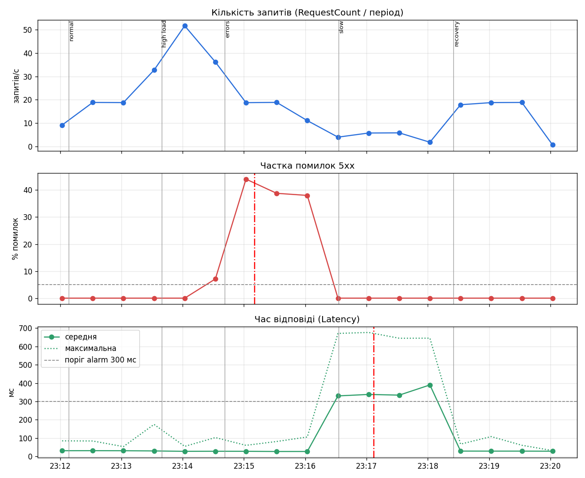

# ЛР-10. Моніторинг і аналіз метрик у CloudWatch (LocalStack)

Код: [`labs/lab10-cloudwatch`](../labs/lab10-cloudwatch), збір метрик — [`labs/lab09-load-balancing/app/metrics.py`](../labs/lab09-load-balancing/app/metrics.py) ·
результати: [`results/`](../labs/lab10-cloudwatch/results)

## 1. Доступ до CloudWatch API

LocalStack зі стеку ЛР-9 (`SERVICES: dynamodb,cloudwatch,sns,sts`), endpoint `http://localhost:4566`:

```bash
cd labs/lab09-load-balancing && METRICS_ENABLED=true docker compose up -d --build
aws --endpoint-url http://localhost:4566 cloudwatch list-metrics --namespace Lab10/ItemsApp
```

## 2–3. Збір і публікація метрик (`PutMetricData`)

`MetricsPublisher` у кожному екземплярі накопичує показники в пам'яті й кожні 10 с відправляє один `PutMetricData`:

| Метрика | Unit | Значення |
|---|---|---|
| `RequestCount` | Count | кількість оброблених запитів (крім `/health`) |
| `ErrorCount` | Count | відповіді зі статусом ≥ 500 |
| `Latency` | Milliseconds | `StatisticValues` (SampleCount, Sum, Min, Max) — без втрати точності середнього |

Namespace `Lab10/ItemsApp`, вимір `Service=items-api` — три екземпляри агрегуються в один ряд.

> Знахідка: спершу публікувались також ряди з виміром `Instance`; LocalStack підсумовував їх у запиті за `Service`,
> і RPS виходив удвічі завищеним. Залишено один набір вимірів.

## 4–5. Отримання й обчислення (`analyze.py`)

- `GetMetricData` — 4 ряди одним запитом (`RequestCount Sum`, `ErrorCount Sum`, `Latency Average/Maximum`), період 30 с;
- `GetMetricStatistics` — агрегат за весь інтервал;
- обчислення: запити за інтервал і RPS, частка помилок `ErrorCount/RequestCount`, середній час `Σ Sum / Σ SampleCount`.

## 6. Alarms (`setup_alarms.sh`)

| Alarm | Метрика | Умова | Дії |
|---|---|---|---|
| `items-api-high-errors` | `ErrorCount` Sum, 30 с | > 10, 1 з 1 періодів | SNS `lab10-alerts` (ALARM і OK) |
| `items-api-high-latency` | `Latency` Average, 30 с | > 300 мс | SNS `lab10-alerts` |

## 7–8. Експеримент (`run_experiment.sh`)

```bash
cd labs/lab10-cloudwatch
pip install -r requirements.txt         # boto3, matplotlib (Python 3.12)
./run_experiment.sh                     # або ANALYZE_IN_DOCKER=1 ./run_experiment.sh
```

| Фаза | Навантаження (`load.py`) | Тривалість |
|---|---|---|
| normal | 20 RPS | 90 с |
| high load | 60 RPS | 60 с |
| errors | 20 RPS, 40% запитів з `?fail=1` → 500 | 90 с |
| slow | 6 RPS, 50% запитів з `?delay_ms=600` | 90 с |
| recovery | 20 RPS | 90 с |

Стан alarm фоново опитується кожні 5 с (`results/alarm_states.csv`):

```
23:12:08  items-api-high-errors  → OK         23:12:08  items-api-high-latency → OK
23:15:10  items-api-high-errors  → ALARM      (фаза errors почалась 23:14:41)
23:17:07  items-api-high-latency → ALARM      (фаза slow почалась 23:16:32)
23:18:08  items-api-high-errors  → OK
23:19:39  items-api-high-latency → OK         (recovery з 23:18:25)
```

## 9. Графіки



Таблиця за періодами — [`results/summary.md`](../labs/lab10-cloudwatch/results/summary.md), сирі дані — `metrics.csv`.

## 10. Висновки

| Фаза | RPS | % 5xx | Сер. затримка |
|---|---|---|---|
| normal | 18,8 | 0 | 31 мс |
| high load | 51,6 (ціль 60) | 0 | 28 мс |
| errors | 18,8 | 38–44% | 27–28 мс |
| slow | 4–6 | 0 | 330–390 мс |
| recovery | 18,8 | 0 | 29 мс |

1. **Продуктивність.** У нормі середній час ~30 мс (з них 20 мс — імітація обробки `WORK_MS`). При 60 RPS система обробила
   ~52 RPS без помилок і без зростання середньої затримки — 3 однопотокові екземпляри ще не насичені (максимум — до ~100 RPS, див. ЛР-9),
   а недобір до 60 — обмеження генератора.
2. **Помилки** не впливають на затримку (збій повертається одразу), але частка 5xx ~40% миттєво перевищує поріг:
   alarm перейшов у ALARM через ~30 с від початку фази (один період 30 с + цикл оцінювання).
3. **Затримки** — середня зросла з 30 до ~340 мс (половина запитів по 620 мс), alarm спрацював через ~35 с.
   У першому прогоні при 15 RPS «повільні» запити перевантажили однопотокові екземпляри: nginx почав повертати 5xx,
   які **не потрапили** в метрики застосунку (запит не дійшов до коду) — метрики на стороні балансувальника так само важливі, як і на стороні застосунку.
4. **Відновлення** — обидва alarm повернулись в OK автоматично; `treat-missing-data notBreaching` не дає alarm-у
   «застрягти» у відсутності даних. Затримка повернення ~1–2 хв визначається періодом агрегації (30 с) і інтервалом оцінювання LocalStack.
5. **Стабільність**: застосунок коректно деградує — помилки й затримки локалізовані (лише «погані» запити), решта
   обробляються з нормальним часом, після зняття навантаження показники повертаються до базових без ручного втручання.
